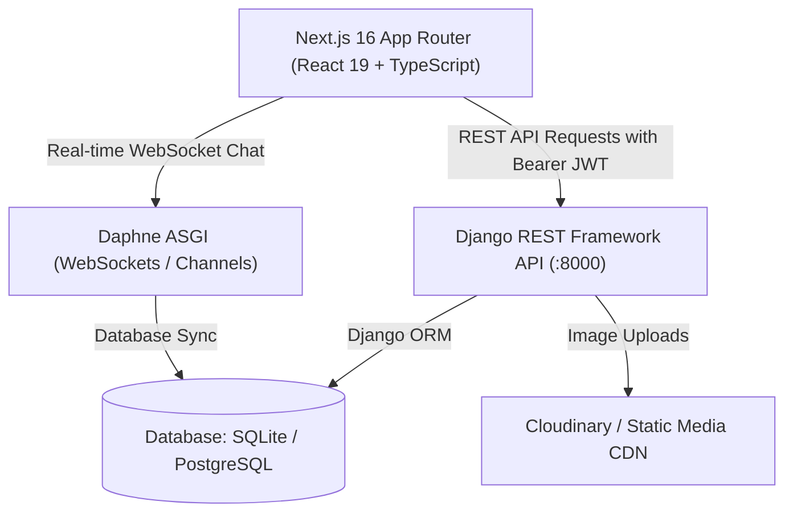
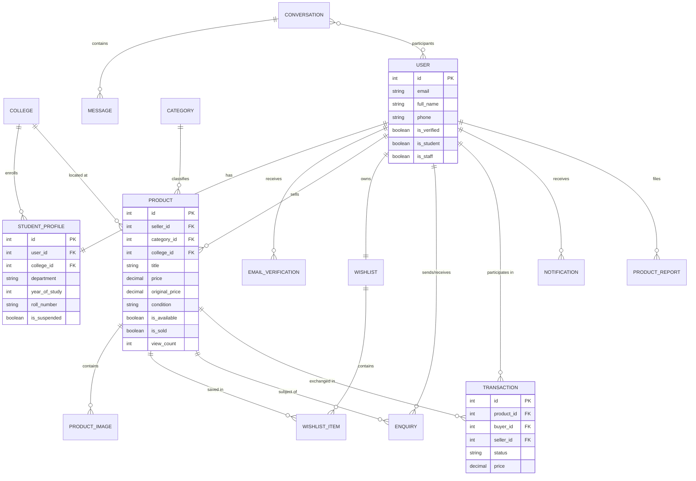

# CampusLoop – Full Stack Campus Marketplace

> **Tagline:** Buy. Sell. Exchange. Within Your Campus.  
> **Category:** Full Stack Web Application (Next.js 14+ & Django REST Framework)

---

## 1. Project Overview & Problem Statement

Currently, university students depend on informal, disorganized WhatsApp groups, Telegram channels, and personal word-of-mouth to buy and sell second-hand course textbooks, scientific calculators, laptops, cycles, and hostel gear. This results in:
- High noise, repeated spam, and unsearchable chat histories.
- Uncertainty about item condition and student verification.
- Fraud risks and difficulty coordinating offline handovers.

**CampusLoop** solves this problem by providing a centralized, secure, searchable, student-exclusive marketplace tailored for university campuses.

---

## 2. Key Features

- **Institutional Student Verification:** Email verification restricted to verified college domains (`.ac.in`, `.edu`) with 6-digit OTP verification.
- **Product Discovery & Search:**
  - Real-time debounced keyword search across titles and descriptions.
  - Granular filters by category, campus/college, condition, price range, and availability.
  - Sorting: newest first, price low-to-high, price high-to-low, and most viewed.
- **Peer-to-Peer Coordination (No Unnecessary Digital Gateway Fees):**
  - Purchase enquiry system: buyers send offers, sellers review buyer profiles and accept/reject.
  - Offline transaction coordination: sellers reserve items and mark them completed after meeting on campus.
- **Wishlist & Saved Searches:** Instant one-click wishlist toggling with database persistence.
- **Seller Management:** Create multi-step listings with condition badges, image galleries, live preview cards, and availability controls.
- **Admin Moderation Console:** Overview metrics, student verification/suspension, listing approval, and report resolution.
- **Pre-Configured Demo Accounts:** One-click demo login buttons for **Student A (IIT Bombay)**, **Student B (BITS Pilani)**, and **Admin** for instant evaluation.

---

## 3. Technology Stack

### Frontend (70% emphasis)
- **Framework:** Next.js 16 (App Router) with React 19 & TypeScript
- **Styling:** Tailwind CSS v4 with custom responsive design system
- **Icons:** Lucide React
- **State Management:** Zustand with localStorage persistence
- **HTTP Client:** Axios with JWT request interceptor and automatic token refresh

### Backend (30% emphasis)
- **Framework:** Django 6.1 with Django REST Framework (DRF)
- **Authentication:** SimpleJWT (Access and Refresh token rotation)
- **Database:** SQLite (default for development/evaluation) / PostgreSQL ready
- **WebSockets:** Django Channels with Daphne ASGI application
- **Image Storage:** Integrated multi-image support with Cloudinary / external storage support

---

## 4. System Architecture



---

## 5. Database ER Diagram



---

## 6. Folder Structure

```
1-fullstack/
├── backend/
│   ├── manage.py
│   ├── config/              # Django settings, master urls, asgi, wsgi
│   ├── accounts/            # User model, student profiles, JWT views, OTP
│   ├── colleges/            # College model, serializers, views
│   ├── categories/          # Category catalog and counters
│   ├── products/            # Product models, images, search/filtering, seed command
│   ├── wishlist/            # Wishlist toggling and list views
│   ├── enquiries/           # Buyer enquiry creation and seller accept/reject
│   ├── messaging/           # Chat conversations, messages, WebSocket consumers
│   ├── transactions/        # Offline coordination status workflow
│   ├── notifications/       # User notification center
│   ├── reports/             # Inappropriate item reporting and admin moderation
│   └── analytics/           # Admin dashboard statistics & user management
├── frontend/
│   ├── src/
│   │   ├── app/
│   │   │   ├── page.tsx             # Homepage (Hero, Categories, Featured, Safety)
│   │   │   ├── marketplace/page.tsx # Search, filter by price/condition/college, sort
│   │   │   ├── products/[id]/page.tsx# Gallery, details, enquiry & report modals
│   │   │   ├── sell/page.tsx        # Listing creator with live card preview
│   │   │   ├── wishlist/page.tsx    # Saved items with one-click remove
│   │   │   ├── dashboard/page.tsx   # Enquiries, listings, transactions, OTP verification
│   │   │   ├── login/page.tsx       # Auth with 1-click evaluation accounts
│   │   │   ├── register/page.tsx    # Student onboarding with college email verification
│   │   │   └── admin/page.tsx       # University admin moderation & statistics
│   │   ├── components/
│   │   │   ├── layout/Navbar.tsx
│   │   │   ├── layout/Footer.tsx
│   │   │   └── products/ProductCard.tsx
│   │   ├── lib/
│   │   │   ├── api.ts               # Axios client with JWT refresh interceptors
│   │   │   ├── store.ts             # Zustand state management
│   │   │   └── types.ts             # Comprehensive TypeScript models
└── README.md
```

---

## 7. API Documentation

| App | Method | Endpoint | Description |
|---|---|---|---|
| **Auth** | POST | `/api/auth/register/` | Register new student account |
| **Auth** | POST | `/api/auth/login/` | Authenticate and obtain JWT tokens |
| **Auth** | GET/PATCH | `/api/auth/profile/` | View or update profile details |
| **Auth** | POST | `/api/auth/send-otp/` | Generate 6-digit verification OTP |
| **Auth** | POST | `/api/auth/verify-email/` | Verify student email with OTP |
| **Colleges**| GET | `/api/colleges/` | List approved campuses and domains |
| **Categories**| GET | `/api/categories/` | List categories with product counts |
| **Products**| GET | `/api/products/` | Filter products (search, condition, price, college) |
| **Products**| POST | `/api/products/` | Create a new product listing with images |
| **Products**| GET | `/api/products/{id}/` | Product details (increments view count) |
| **Products**| POST | `/api/products/{id}/mark_sold/` | Mark product as sold |
| **Products**| GET | `/api/products/my_listings/` | List seller's own products |
| **Wishlist**| GET | `/api/wishlist/` | View saved wishlist items |
| **Wishlist**| POST | `/api/wishlist/toggle/` | Add or remove item from wishlist |
| **Enquiries**| POST | `/api/enquiries/` | Send purchase enquiry to seller |
| **Enquiries**| POST | `/api/enquiries/{id}/accept/`| Seller accepts purchase enquiry |
| **Transactions**| POST | `/api/transactions/` | Create transaction coordination record |
| **Transactions**| POST | `/api/transactions/{id}/update_status/` | Update status (`reserved`, `completed`, `cancelled`) |
| **Admin** | GET | `/api/admin/dashboard/` | Aggregated university metrics |
| **Admin** | POST | `/api/admin/users/{id}/toggle_suspend/` | Suspend or reactivate student |
| **Admin** | POST | `/api/admin/products/{id}/toggle_approval/` | Approve or take down listing |

---

## 8. Installation & Setup Instructions

### Backend Setup (Django)

1. Open PowerShell and navigate to the backend directory:
   ```powershell
   cd e:\1-fullstack\backend
   ```
2. Apply database migrations:
   ```powershell
   python manage.py migrate
   ```
3. Seed the database with realistic colleges, categories, student accounts, and 22+ campus products:
   ```powershell
   python manage.py seed_data --clear
   ```
4. Run the automated backend test suite:
   ```powershell
   python manage.py test
   ```
5. Start the development server:
   ```powershell
   python manage.py runserver 8000
   ```

### Frontend Setup (Next.js)

1. In a new terminal, navigate to the frontend directory:
   ```powershell
   cd e:\1-fullstack\frontend
   ```
2. Build the production application:
   ```powershell
   npm run build
   ```
3. Start the frontend application:
   ```powershell
   npm run dev
   ```
4. Access the web app at `http://localhost:3000`.

---

## 9. Mandatory Demonstration Workflow (15 Steps)

The application has been verified to support the complete 15-step demonstration required by university evaluation criteria:

1. **Step 1:** Log in as **Student A** using 1-Click Login (`student_a@iitb.ac.in` / `student123`).
2. **Step 2:** Open the student dashboard (`/dashboard`).
3. **Step 3:** Navigate to **Sell an Item** (`/sell`) and fill in a course textbook listing with title, condition, price, and photo.
4. **Step 4:** Review the live card preview and publish the listing.
5. **Step 5:** Sign out and log in as **Student B** (`student_b@bits.ac.in` / `student123`).
6. **Step 6:** Open **Marketplace** (`/marketplace`) and search for the textbook title.
7. **Step 7:** Apply category and price range filters.
8. **Step 8:** Click **View Details** to inspect the product page (`/products/[id]`).
9. **Step 9:** Click the heart icon to add the product to your Wishlist.
10. **Step 10:** Click **Send Purchase Enquiry** and propose a campus meeting time/spot.
11. **Step 11:** Sign out and log back in as **Student A**.
12. **Step 12:** Open `/dashboard?tab=enquiries` and click **Accept Enquiry**.
13. **Step 13:** Switch to the **Transactions** tab and click **Mark as Reserved** (the item availability updates automatically).
14. **Step 14:** Meet on campus and click **Confirm Handoff Completed** (the product is marked as Sold Out).
15. **Step 15:** Refresh the browser — all states, listings, transactions, and status updates persist cleanly in the database.
